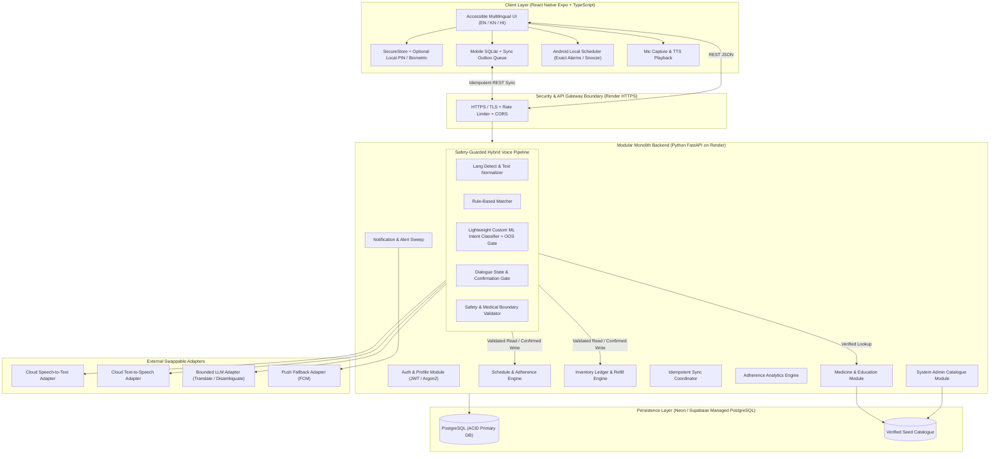

# Initial System Architecture: NityaMed

**Project:** NityaMed — Medicine Continuity Management System (MCMS)  
**Version:** 1.0 (Initial Proposed Architecture — Pre-Implementation)

> **Note:** This document defines the **initial proposed architecture**. Exact third-party speech/LLM vendors and concrete SQL migration scripts will be finalized as implementation-ready artifacts before coding begins.

---

## 1. Architecture Overview
**NityaMed** uses an **Offline-First Cross-Platform Client + Modular Monolith Backend** architecture. Because patient safety, stock accounting, and adherence states require strict consistency while mobile connectivity in India can be intermittent, all deterministic continuity rules execute transactionally in the backend (and mirror safely in mobile SQLite for offline resilience), while AI/speech components sit behind strict validation and confirmation gates.

---

## 2. Proposed Architectural Style
- **Backend Style — Modular Monolith (Python / FastAPI):**
  A single deployable backend divided into strict, loosely coupled domain modules (`auth`, `medicines`, `schedules`, `adherence`, `inventory`, `refill`, `notifications`, `assistant`, `ml_intent`, `analytics`, `admin`).
  - *Why over Microservices:* Eliminates distributed-transaction complexity, network serialization overhead, and multi-service DevOps burden for a solo developer, while preserving clean module boundaries so any module (e.g., `ml_intent`) can later be extracted if needed.
- **Client Style — Offline-First Mobile App + Connected Web Companion (React Native / Expo):**
  Shared UI and business-state layer across Android and Web, using an explicit **Sync Outbox Pattern** on mobile (`SQLite -> idempotent REST sync -> PostgreSQL`).

---

## 3. System Architecture Diagram

---

## 4. Major Components & Responsibilities

### 4.1 Client Layer (React Native Expo)
1. **Multilingual Accessible UI:** Renders large-font, high-contrast screens across Android and Web (`react-native-web`) using localized resource bundles (`EN`, `KN`, `HI`).
2. **Offline Storage & Sync Outbox (Mobile):** Stores active medicines, schedule versions, pending dose events, and queued confirmation/stock events in `expo-sqlite` with client-generated UUIDs (`client_event_id`).
3. **Local Notification Scheduler (Android):** Schedules upcoming alarms directly on the device OS, handles `Mark Taken` / `Snooze` actions, enforces lock-screen privacy masking, and checks battery-optimization status.
4. **Audio & Voice Controller:** Records user voice clips, sends audio/text to the backend assistant endpoint, displays confirmation cards before state changes, and plays back TTS audio.

### 4.2 Backend Layer (FastAPI Modular Monolith on Render)
1. **Auth & Profile (`auth`):** Email/password registration & login, Argon2id hashing, JWT access/refresh rotation, profile/language/notification settings, data export, and account deletion.
2. **Medicine & Education (`medicines`):** Catalogue search, custom medicine fallback, and verified non-diagnostic educational retrieval (always attaching source + verification date).
3. **Schedule & Adherence Engine (`schedules`, `adherence`):** Immutable schedule versioning, daily dose-event materialization, strict state transitions (`Pending` -> `Taken on time` / `Taken late` / `Skipped` / `Partially taken` / `Expired unconfirmed`), and audit-logged accidental confirmation corrections.
4. **Inventory & Refill Engine (`inventory`, `refill`):** Append-only `stock_transactions` ledger, exact Confirmed Stock vs. estimated Projected Stock, physical reconciliation, and deterministic depletion-date calculation.
5. **Idempotent Sync Coordinator (`sync`):** Processes batched offline client events safely using `client_event_id` deduplication so retries never double-deduct stock.
6. **Lazy Sweep & External Cron Support (`jobs`):** Because free-tier Render services sleep when idle, dose-expiry and refill sweeps run **lazily on user sync/agenda load** AND can be invoked via a secured cron endpoint (while primary alarms stay local on Android).
7. **Hybrid Voice & Custom ML Pipeline (`assistant`, `ml_intent`):**
   - Runs **Language Detection -> Normalization -> Rules -> Lightweight Custom ML Intent Model** locally in Python (`<100 ms`, low RAM footprint for Render free tier).
   - Uses **Bounded LLM** *only* when rules/entities need disambiguation or verified text needs plain-language translation/simplification.
   - Enforces **Safety & Confirmation Gates** before calling internal `adherence`, `inventory`, or `medicines` services.
8. **Analytics (`analytics`):** Computes transparent adherence formulas and non-diagnostic irregular-pattern summaries.
9. **Admin Module (`admin`):** Restricted to catalogue curation and anonymized system health monitoring.

---

## 5. Component Interactions & Key Data Flows

### Flow A: Offline Dose Confirmation -> Sync -> Stock Deduction
1. Android local alarm triggers at `08:00` (privacy-safe text).
2. Patient taps **Taken** while offline.
3. Mobile client generates `client_event_id` (UUID), updates local SQLite dose state (`Taken on time`), deducts local confirmed balance, and inserts the event into `sync_outbox`.
4. When internet returns, `Sync Coordinator` sends the queued batch over HTTPS to `POST /api/v1/sync/events`.
5. Backend checks `client_event_id` inside a PostgreSQL transaction:
   - If unseen: validates ownership, transitions `dose_event`, appends `-1 DOSE_CONFIRMED` to `stock_transactions`, updates refill projection, and acknowledges success.
   - If already processed: returns prior acknowledgment without modifying stock again.

### Flow B: Hybrid Voice Action (e.g., *"I bought one more strip of Dolo"*)
1. Mobile records audio -> sends to `POST /api/v1/assistant/voice`.
2. **STT Adapter** transcribes audio -> **Normalizer** cleans script/romanized variations.
3. **Rules + Custom ML Intent Classifier** predicts `intent = update_stock_purchase` with confidence score (rejecting out-of-scope inputs early).
4. **Entity Extractor** resolves `medicine = Dolo`, `quantity = 1 strip`.
5. **Backend Lookup** resolves user's personal medicine (`Dolo 650 mg`, `1 strip = 15 tablets`).
6. **Dialogue State + Confirmation Gate** stores a pending confirmation token in `conversation_states` and replies (via text + **TTS**): *"Do you want to add 15 tablets to your Dolo 650 mg stock?"*
7. Only after explicit **"Yes" / Confirm** tap or voice confirmation does the backend execute `PURCHASE +15` in `stock_transactions`.

---

## 6. Database Overview (Initial Logical Design)

All primary entities live in **PostgreSQL** (hosted on Neon or Supabase) with strict foreign keys, `user_id` ownership columns, timestamps (`UTC`), and soft-delete flags where history must survive:

- **`users` & `patient_profiles`:** Credentials, role (`patient` / `admin`), preferred language (`en`/`kn`/`hi`), timezone, notification & privacy flags.
- **`medicine_catalogue` & `medicine_education`:** Shared verified brands, generics, strengths, forms, standard pack sizes, verified education fields, source name, verification date.
- **`personal_medicines`:** User-owned medicines (linked to `catalogue_id` OR marked `is_custom = true`), prescribed dose per intake, base stock unit, active/paused/completed status.
- **`schedule_versions`:** Immutable schedule rules (`frequency_type`, time slots, variable doses, start/end dates, `effective_from`, `effective_to`).
- **`dose_events`:** Materialized scheduled doses linked to `schedule_version_id`, current `status`, `confirmed_quantity`, `client_event_id` (unique idempotency constraint).
- **`stock_transactions`:** Append-only ledger (`transaction_type`, `quantity_delta`, `balance_after`, `dose_event_id`, `client_event_id`, `notes`).
- **`notifications`:** Scheduled/dispatched reminder & refill alert records with deduplication keys.
- **`audit_logs`:** Immutable trail of corrections, deletions, exports, and admin catalogue changes.
- **`conversation_states`:** Short-lived assistant context & pending confirmation payloads (never trusted without backend re-validation).

---

## 7. Security Boundaries & Trust Zones

1. **Untrusted Zone (Device / Browser / Speech Input / LLM Output):**
   - Client requests, transcribed speech, and **LLM responses** are treated as untrusted inputs.
   - The LLM has **no database credentials, no SQL/ORM tools, and no autonomous API execution**.
2. **Authentication & Ownership Boundary (FastAPI Middleware & Services):**
   - Every protected endpoint validates JWT signature, checks user active status, and enforces `resource.user_id == current_user.id` inside database queries.
   - Admin endpoints strictly reject patient-data queries and restrict scope to `medicine_catalogue` and system health metrics.
3. **Persistence Boundary (PostgreSQL):**
   - Parameterized SQL queries via SQLAlchemy ORM (preventing SQL injection).
   - Transactional locks / unique constraints on `client_event_id` prevent race conditions during concurrent syncs.
4. **Device Privacy Boundary:**
   - Access/refresh tokens stored in `expo-secure-store` (encrypted OS keystore).
   - Lock-screen notifications omit drug names unless explicitly opted in.

---

## 8. Deployment Overview (Render + Persistent Managed PostgreSQL)

- **Backend API & ML Inference:** Dockerized **FastAPI** Web Service on **Render** (free tier for academic demo). Deploys lightweight `scikit-learn` / compact intent classifier artifacts (`joblib`/`ONNX`) within container RAM limits; heavier Transformer experiments remain offline in the training/benchmarking notebooks.
- **Database:** Persistent **PostgreSQL** on **Neon** or **Supabase** (chosen over Render's short-lived free Postgres to avoid database expiration), connected via TLS.
- **Web Companion:** Expo static web bundle hosted on **Render Static Site** (free, zero spin-down).
- **Mobile App:** Expo EAS build generating an installable Android `.apk` for physical device testing.
- **Scale-Out Path (Future):** Upgrade Render tier to eliminate spin-down or extract background worker (ARQ/Celery + Redis) and ML inference into independent services without changing client contracts.

---

## 9. Important Assumptions & Unresolved Decisions (To Finalize Before Implementation)

| Item | Current Proposed Status | Needs Final Decision Before Coding |
| :--- | :--- | :--- |
| **External Speech & LLM Vendors** | Provider-agnostic adapters planned | Select specific free/low-cost providers supporting `en`, `kn`, `hi` based on quota availability. |
| **Deployed ML Artifact vs. Offline Benchmark** | Deploy lightweight TF-IDF + Linear/LogReg or compact FastText on Render | Benchmark heavier multilingual transformers offline; deploy the best model fitting Render's memory envelope. |
| **Mobile Local Storage Sync Scope** | Sync last 30 days + next 14 days to mobile SQLite | Confirm offline history window size so SQLite stays fast on low-end Android phones. |
| **Seed Medicine Dataset** | Curated ~200–500 common Indian medicines + generic education | Finalize dataset sources during Module 10 evaluation. |
