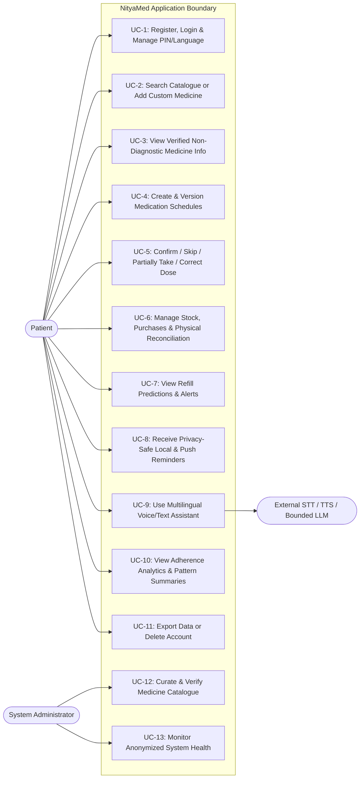
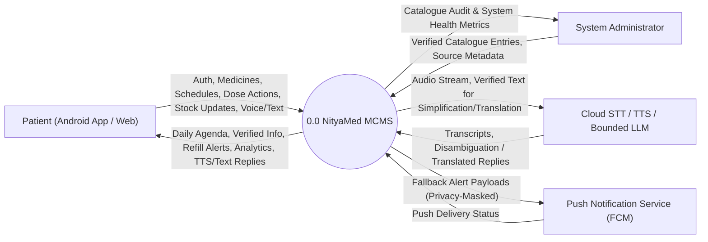
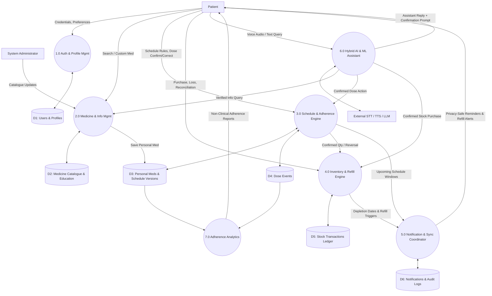
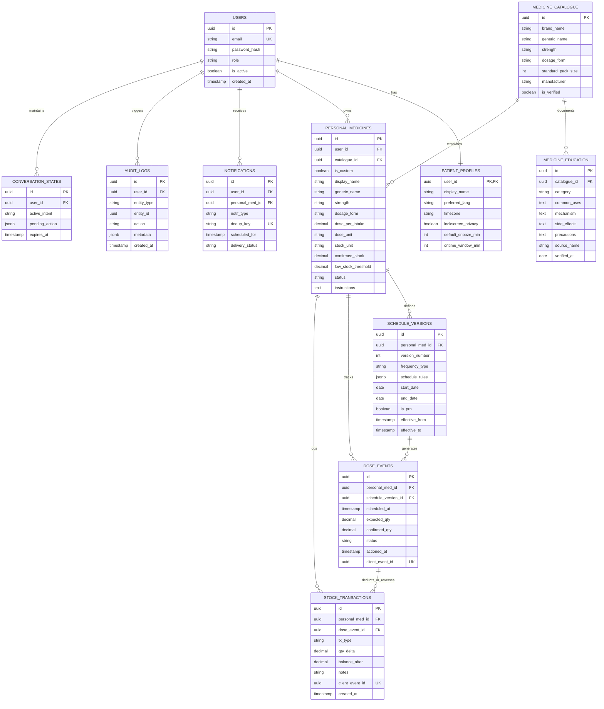
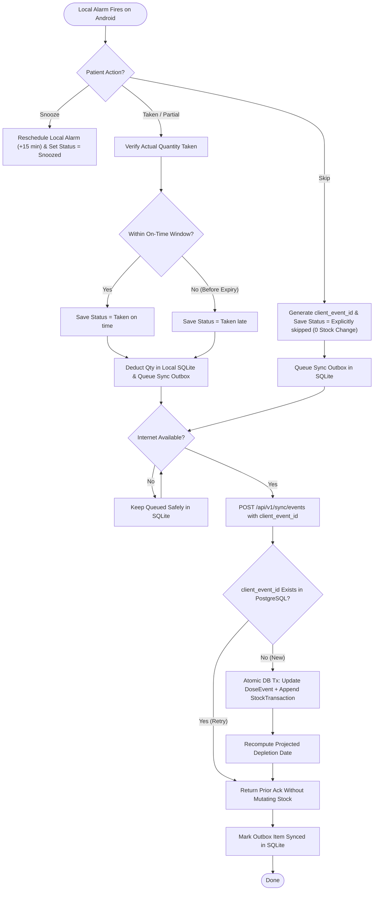
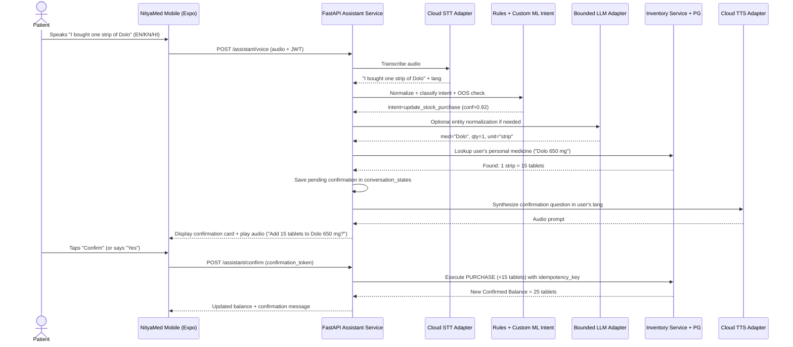
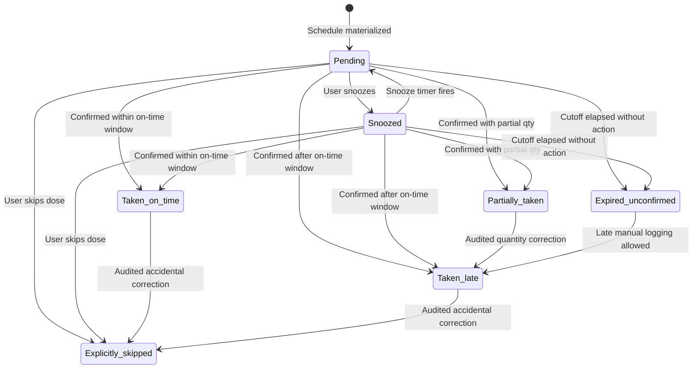
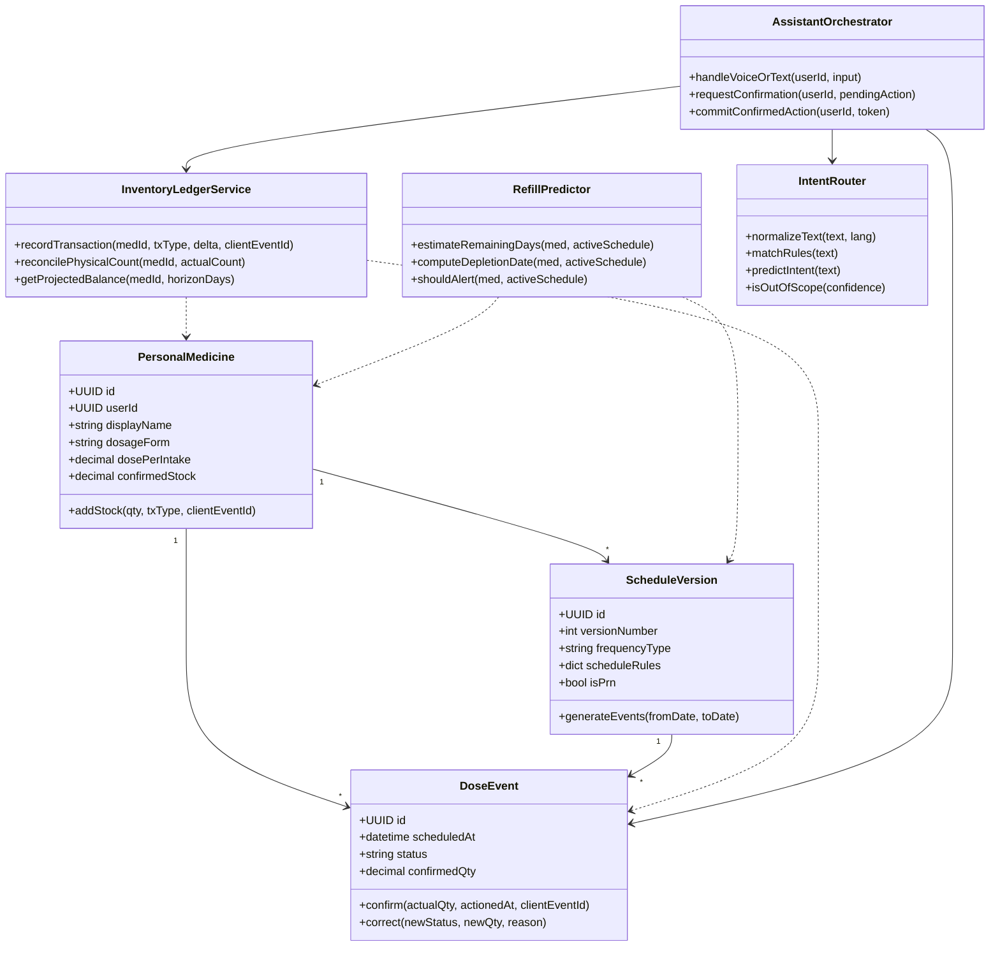
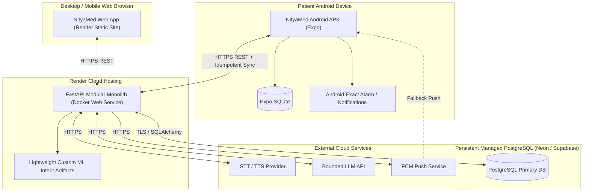

# System Diagrams: NityaMed

**Project:** NityaMed — Medicine Continuity Management System (MCMS)  
**Baseline:** Consistent with SRS v1.0 & Initial Architecture v1.0 (Patient + System Admin only; Caregiver deferred to Phase 2; no doctor portal)

---

## 1. Use Case Diagram

**Explanation:** Shows every primary interaction boundary for the two MVP actors (**Patient** and **System Administrator**), plus supporting external services for speech/LLM and push fallback.

---

## 2. Context Diagram (DFD Level 0)

**Explanation:** Treats NityaMed as a single system boundary, illustrating all high-level data entering and leaving the platform.

---

## 3. Data Flow Diagram — Level 1 (DFD Level 1)

**Explanation:** Decomposes NityaMed into seven core functional processes (`1.0` to `7.0`) and six logical data stores (`D1` to `D6`), showing how schedules, dose events, stock transactions, and the hybrid assistant interact without bypassing validation.

---

## 4. Entity-Relationship (ER) Diagram

**Explanation:** Models the PostgreSQL relational schema. `MEDICINE_EDUCATION` is separated from `PERSONAL_MEDICINES` with source and date attribution; `SCHEDULE_VERSIONS` preserves historical regimens; and `DOSE_EVENTS` + `STOCK_TRANSACTIONS` enforce unique `client_event_id` keys for offline idempotency.

---

## 5. Activity Diagram: Offline Dose Confirmation & Idempotent Sync

**Explanation:** Traces what happens when a patient acts on a scheduled dose while offline, ensuring local SQLite reflects reality immediately while PostgreSQL prevents duplicate deductions during synchronization.

---

## 6. Sequence Diagram: Hybrid Voice Assistant Stock Update

**Explanation:** Demonstrates the safety-guarded pipeline (`STT -> Normalization -> Rules/ML Intent -> Confirmation Gate -> Validated Backend Transaction -> TTS`). No database write occurs until the user explicitly confirms.

---

## 7. Dose Event State Machine

**Explanation:** Enforces the SRS safety rule that unanswered doses become `Expired unconfirmed` (never automatically `Taken` or `Missed`) and accidental confirmations can be corrected through an audited flow.

---

## 8. Core Domain Class Diagram

**Explanation:** Shows the clean domain/service structure inside the FastAPI Modular Monolith, keeping deterministic logic cleanly separated from AI routing.

---

## 9. Deployment Diagram

**Explanation:** Maps where every NityaMed runtime component executes using Render (Backend + Static Web) paired with persistent managed PostgreSQL (Neon/Supabase) and Expo Android APK builds.

